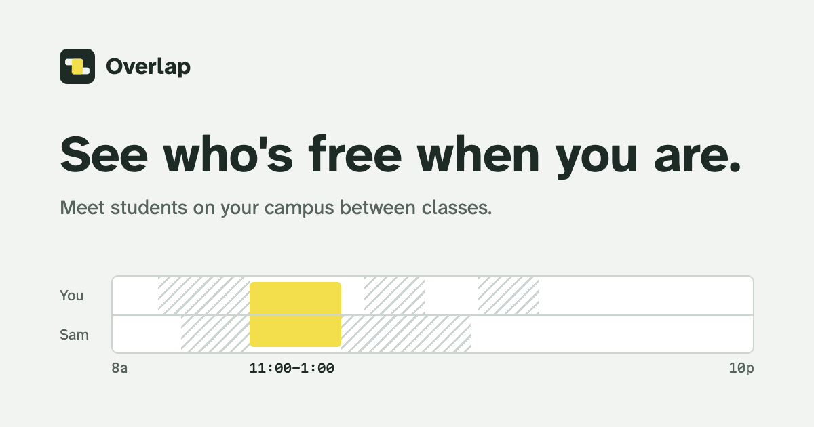

# Overlap



Overlap helps college students meet people who are free at the same time they are. You add your classes, and Overlap shows other students at your campus whose gaps between classes line up with yours. If you both wave, you see each other's contact handle. It's built for commuters and transfer students, who often arrive after friend groups have formed.

It's live at **[overlap.christianhong.dev](https://overlap.christianhong.dev)** for UC Irvine and UC Riverside students.

## What it does

- **Schedule:** add a class by its section code (UCI) or CRN (UCR). Meeting times are looked up automatically.
- **On-campus hours:** set when you're on campus each weekday, so matching counts the time before your first class and after your last.
- **Matches:** pick a weekday and see who's free when you are, with the shared windows drawn on a time strip, plus classes, major, or transfer school you have in common.
- **Waves:** wave at someone, optionally with a short note. When it's mutual, you both see each other's contact handle.
- **Meetups:** post or join small activities on campus, with a spot limit.
- **Profile photos:** optional, resized and stripped of location data before they're stored.
- **Emails:** sign-in codes, plus a note when someone waves or you connect, at most one a day.
- **Safety:** block or report anyone. Reports go to an admin page with the evidence and options to dismiss, remove a photo, or ban.

Students only ever see others at their own campus.

## How it's built

- **Backend:** Python, FastAPI, SQLAlchemy, Alembic, and Postgres. Sign-in is by emailed code, with no passwords.
- **Frontend:** React, Vite, TypeScript, Tailwind, and TanStack Query. API types are generated from the backend's OpenAPI schema, so the two can't drift apart.
- **Course data:** [Anteater API](https://docs.icssc.club/docs/developer/anteaterapi) for UCI, and UCR's public class search for UCR.
- **Services:** Render (API), Vercel (site), Neon (database), AWS S3 (photos), and Resend (email).
- **Checks:** every pull request runs backend tests and lint, frontend lint, type check, tests, and build, and confirms the generated API types are current.

## Run it locally

You need [uv](https://docs.astral.sh/uv/), Node 22 or newer, and Docker.

Backend, from the repo root:

```
docker compose up -d
cp .env.example .env
uv sync
uv run alembic upgrade head
uv run uvicorn app.main:app --reload
```

The API runs at http://localhost:8000, with interactive docs at http://localhost:8000/docs.

Frontend, in a second terminal:

```
cd web
cp .env.example .env
npm install
npm run dev
```

Open http://localhost:5173 and sign in with any `@uci.edu` or `@ucr.edu` address. In dev mode, no email is sent; the code appears on the sign-in screen. Photo uploads stay off until you add AWS settings to `.env`.

## Checks

From the repo root:

```
uv run pytest
uv run ruff check app tests
uv run ruff format --check app tests
```

From `web/`:

```
npm run lint
npm run typecheck
npm test
npm run build
```

After changing the API, run `npm run gen:api` in `web/` and commit the updated `src/api/schema.d.ts`. CI fails if it's out of date.

## Project layout

```
app/            backend
  routers/      API endpoints: auth, profiles, schedule, matches, waves, activities, admin
  anteater.py   UCI course lookup
  ucr.py        UCR course lookup
  matching.py   free time and overlap
  models.py     database tables
  schemas.py    request and response shapes
migrations/     database migrations
tests/          backend tests
scripts/        API schema export
web/src/
  pages/        one file per page
  components/   shared pieces like the time strip and avatar
  api/          API client and generated types
  data/         campuses, majors, community colleges
```

## Configuration

The backend reads these from the environment, or from `.env` locally. `.env.example` lists them all.

| Variable | What it's for | Needed in production |
|---|---|---|
| `DATABASE_URL` | Postgres connection | Yes |
| `JWT_SECRET` | Signs sign-in tokens, 32+ random characters | Yes |
| `DEV_MODE` | Shows sign-in codes on screen instead of emailing them | No, leave unset |
| `RESEND_API_KEY` | Sends email | Yes |
| `EMAIL_FROM` | Sender name and address | Yes |
| `SITE_URL` | Links in emails | Yes |
| `CORS_ORIGIN` | JSON list of site addresses allowed to call the API | Yes |
| `CORS_ORIGIN_REGEX` | Pattern for preview deployments | No |
| `ADMIN_EMAILS` | JSON list of accounts that can review reports | Yes |
| `AWS_ACCESS_KEY_ID`, `AWS_SECRET_ACCESS_KEY`, `AWS_REGION`, `PHOTO_BUCKET` | Photo storage | For photos |
| `CURRENT_TERM` | Overrides the current term, like `2026-fall` | No |
| `TIMEZONE` | Campus time zone | No |
| `MIN_GAP_MINUTES`, `MIN_OVERLAP_MINUTES` | Shortest gap and shared window that count | No |

The frontend needs one: `VITE_API_URL`, the API's address.

Production refuses to start without a real `JWT_SECRET` and `RESEND_API_KEY`.

## Adding a campus

1. Write a lookup for the campus's class search that returns `SectionData`, like `app/ucr.py`.
2. Add it to `FETCHERS` in `app/routers/schedule.py`.
3. Add the campus to `web/src/data/campuses.ts`, with its majors.
4. Add its row to `app/seed.py`. This opens sign-ups for its email domain, so do it last.

## Credits

UCI course data comes from [Anteater API](https://docs.icssc.club/docs/developer/anteaterapi) by [ICSSC](https://studentcouncil.ics.uci.edu/). UCR course data comes from UCR's public class search.

Overlap is an independent student project. It isn't affiliated with or endorsed by UC Irvine or UC Riverside.
